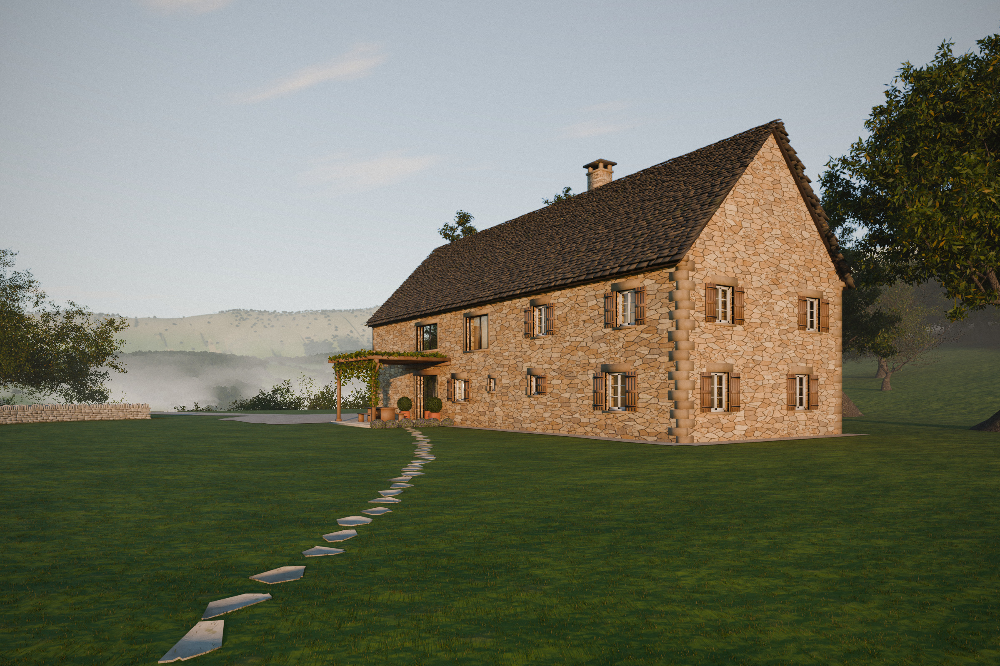
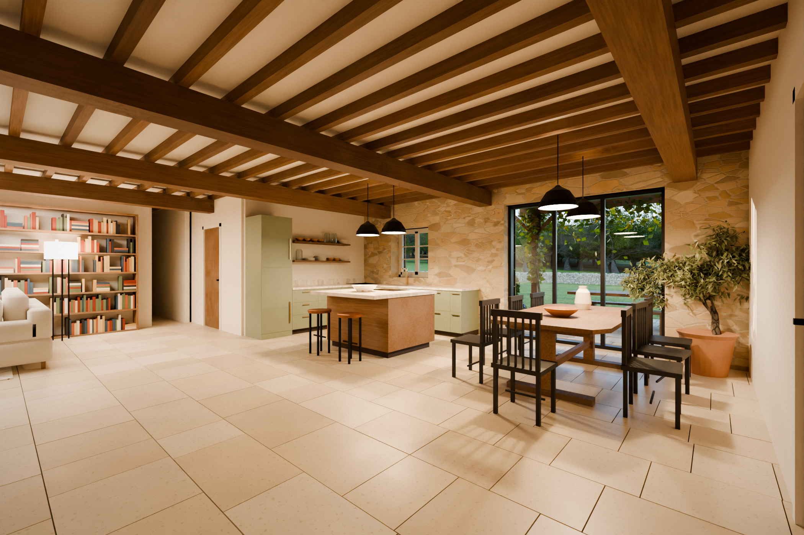
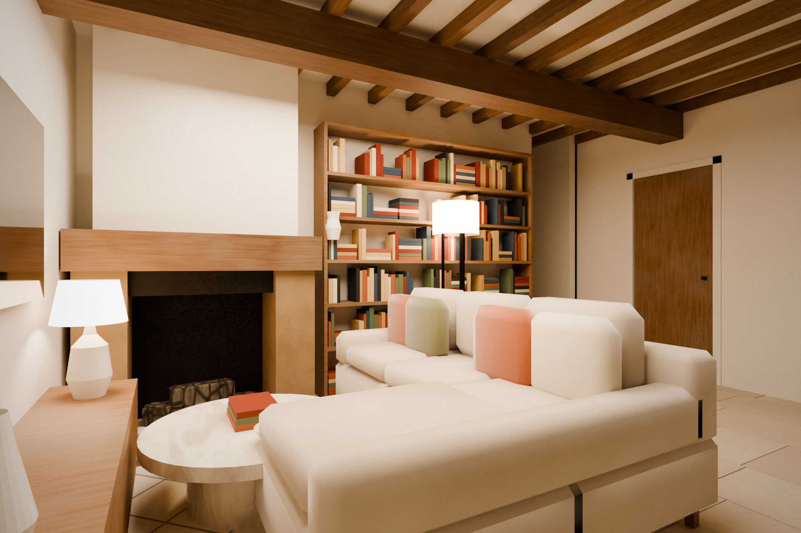

# Maison en Aveyron: exterior render built from the hand-drawn plan



This picture is **not** an AI image. It is a physically based path-traced render
(Blender Cycles) of a 3D model built from the sketch (`plan_croquis.jpg`), so the footprint,
proportions, rooms and openings follow the plan exactly.

## How the plan was read

The plan's outer rectangle (both floors share the same footprint) is mapped to **25.0 m × 9.4 m**.
The top edge of the plan is the **garden side**. The only window drawn on the plan (above the table)
is there. The entrance **E** and the staircase are on the bottom edge. The garage is at the right end.

| Room (plan) | Floor | Facade opening in the model |
|---|---|---|
| chambre | RDC | garden window with oak shutters + left-gable window |
| SDB | RDC | small window, single oak shutter (garden) |
| WC | RDC | small fixed window (garden) |
| cuisine (L worktop + island) | RDC | window above the worktop, oak shutters (garden) |
| table, opening drawn on the plan | RDC | **large modern glass sliding bay**, oak lintel, terrace + oak pergola with vine |
| zone hachurée | RDC | blind stone wall (no opening) |
| bureau / bibliothèque | RDC | left-gable window (the bookcase wall, on the entrance side, stays blind) |
| buanderie / cellier / PC | RDC | small window on the entrance side |
| salon: canapé, cheminée, TV | RDC | stone chimney stack on the roof |
| entrée **E** | RDC | oak plank door (entrance side) |
| garage | RDC | oak double garage door (right gable) |
| chambre 1 | étage | garden window + left-gable window, oak shutters |
| chambre 2 | étage | garden window, oak shutters |
| jeux | étage | **large modern window** (garden) |
| palier / escalier | étage | **large modern window**, aligned above the glass bay |
| chambre 3, SDB, WC | étage | windows on the entrance side and left gable |
| unlabeled area above the garage | étage | no opening (attic) |

The interior partitions and the main furniture (kitchen worktop, island, table, sofa) are also modelled from the
plan, so what you see through the glass is consistent.

Assumptions: the sketch has no scale, so the 25 m × 9.4 m size was chosen to give realistic room sizes.
The hatched area is read as an enclosed space with no window. Windows that the plan does not draw were
placed one per room, centred on each room's exterior wall.

## Interior (ground floor living space)




The open space between the WC/bathroom block and the garage wall follows the plan:

* **Kitchen:** L-shaped worktop along the WC wall and under the garden window (sink under the window),
  plus a central island with a hob and two stools. Fronts are sage green with brass handles, the worktops
  honed stone. There are open oak shelves on the WC wall.
* **Dining:** an oak farmhouse table in the position drawn on the plan, in front of the large glass bay,
  with spindle-back chairs and two black pendant lamps.
* **Séjour:** an L-shaped linen sofa facing the TV on the entrance wall, a stone fireplace (*cheminée*)
  with an oak mantel beam on the west wall, built-in oak bookshelves, a wool rug and a round stone coffee table.
* **Stair:** quarter-turn stair in the corner by the garage wall (D → A on the plan), plastered with oak treads
  and a black steel handrail, under a matching opening in the ceiling.
* **Doors:** oak doors to the WC, the shoe/coat closet and the garage, as on the plan.
* **Finishes:** limestone flag floor, exposed oak beams and joists with a white ceiling, exposed stone on the
  garden wall, lime plaster elsewhere.
* **Light:** golden-hour sun through the glass bay (filtered by the pergola), warm pendants and a floor lamp.
  The interior shots use a slightly higher sun (9°) so the light reaches inside.

## Architecture / setting

* Coursed rubble limestone walls (warm beige-golden), lime pointing, dressed quoins, lintels and sills
* Steep (47°) roof of individual schist *lauzes* (several thousand individually modelled slabs), stone chimney with lauze cap
* Natural oak plank shutters with battens, painted casement windows, anthracite frames on the modern openings
* Limestone-paved terrace, oak pergola with vine, lavender, potted box balls, stepping-stone path across the lawn
* Dry-stone walls, gravel courtyard and drive to the garage, old chestnut and oak trees
* Gentle slope above a valley, bocage hills and the Causse escarpment; golden hour sun,
  aerial haze and mist in the valley (height-fog post-process)
* 24 mm lens, full frame, eye level, vertical lines kept straight

## Visite 360° (page à partager)

`visite/` contient la page de visite : les rendus, le plan et trois panoramas 360° (jardin, terrasse,
séjour) reliés par des flèches. Le viewer est Pannellum (open source).

* `visite/index.html` est la version publiée sur claude.ai.
* `visite/standalone.html` est la même page en document HTML complet. Elle s'héberge telle quelle (GitHub Pages,
  Netlify…) avec les dossiers `img/` et `panos/`. Elle doit être servie par un serveur web : ouverte
  directement depuis le disque, le navigateur bloque le chargement des panoramas.
* Les panoramas sont rendus avec `VIEW=pano_jardin|pano_terrasse python build_scene.py pano …` et
  `VIEW=pano_sejour python build_scene.py pano_int …`, puis `python visite/gen_page.py <dossier des .json> visite`.

## Re-render

```bash
pip install bpy==5.2.3 OpenEXR pillow   # Python 3.13
cd blender
python build_scene.py final ../rendu/render.exr   # ~15 min on 4 CPU cores
python post.py ../rendu/render.exr ../rendu/maison_aveyron_golden_hour.jpg
```

`CAM='{"pos":[-30,24],"target":[8,-2]}'` changes the viewpoint. Presets: `preview`, `mid`, `final`.

Interiors: `VIEW=int_kitchen` or `VIEW=int_living` with the `final_int` preset, then
`python post.py render.exr out.png haze=0 mist=0 clouds=0 exposure=2.7` (kitchen) or `exposure=1.35` (living, `INT_SPP=1.4`).

To use an AI image generator instead, see [`PROMPT_IA.md`](PROMPT_IA.md). Give it the render as the
reference image so it keeps the layout.
